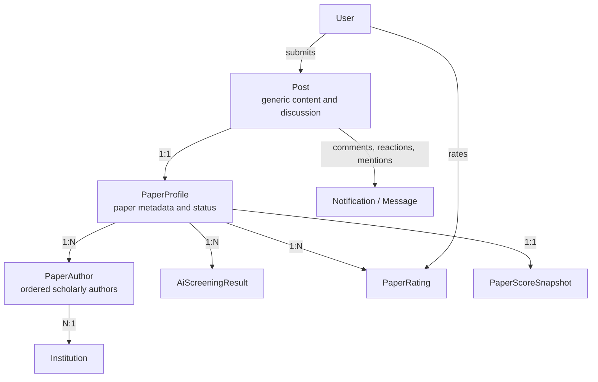
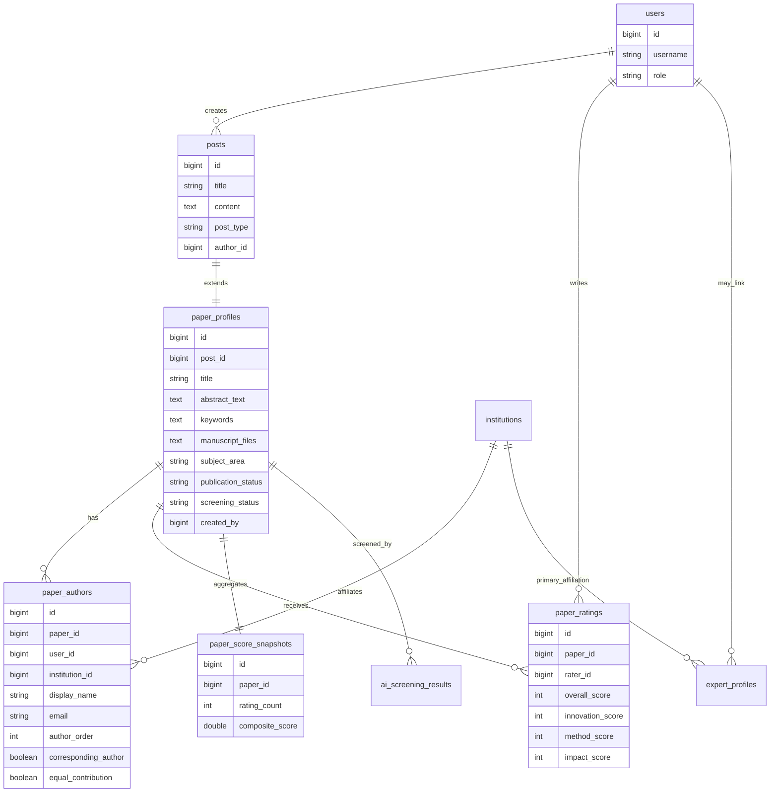
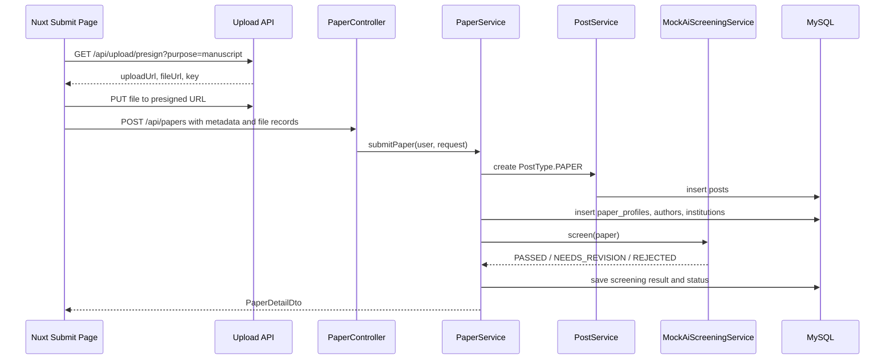

# OpenIsle Paper Platform Interview Technical Guide

> 面试用途：帮助候选人用标准软件工程语言解释本项目，而不是只说“我基于开源项目改了一个页面”。
>
> 适用对象：前端、后端、全栈、产品技术方向面试。
>
> 当前定位：这是一个基于 OpenIsle 二次开发的英文论文社交与知识服务平台。现阶段是 MVP 骨架，不应包装成已经完整商业化上线的成熟系统。

## 1. 一分钟项目介绍

我做的是一个英文论文社交与知识创造平台，底层基于开源社区系统 OpenIsle 做二次开发。原系统已经有用户、发帖、评论、通知、私信、后台管理等社区能力，我没有从零重写这些通用模块，而是在它之上扩展论文业务层。

核心业务链路是：

1. 作者登录后提交论文。
2. 系统保存论文元数据、作者、机构、正文、附件。
3. 后端创建一条 `PostType.PAPER` 的社区内容，用于复用评论、通知、互动能力。
4. 同时创建 `PaperProfile` 作为论文业务主表。
5. MVP 阶段通过 mock AI screening 做准入检查。
6. 通过后公开为 `PUBLISHED`。
7. 登录用户可以评分，评分聚合成 `PaperScoreSnapshot`。
8. 排名页展示论文、作者、机构排名。

长期商业化方向不是单纯“搜论文”，而是基于投稿作者、论文元数据和结构化抽取结果，建设专家数据库、文献数据库和知识数据库，为企业或研究团队提供知识查询服务。

## 2. 技术栈总览

| 层级 | 技术 | 当前作用 |
| --- | --- | --- |
| 前端 | Nuxt 3 / Vue 3 | SSR 应用、页面路由、论文提交、论文列表、排名、登录跳转 |
| 前端通信 | `$fetch` / Runtime Config | 调用后端 REST API，区分浏览器与 SSR API 地址 |
| 前端实时 | STOMP / SockJS | 复用 OpenIsle 私信、频道、通知实时未读数 |
| 后端 | Spring Boot 3.1 / Java 17 | REST API、业务服务、鉴权、安全、上传、论文业务 |
| ORM | Spring Data JPA / Hibernate | 实体映射、Repository 查询、事务管理 |
| 数据库 | MySQL 8 | 用户、帖子、论文、作者、机构、评分等业务表 |
| 缓存/状态 | Redis | 复用 OpenIsle 在线状态、访问记录、部分缓存能力 |
| 消息队列 | RabbitMQ | 通知、WebSocket 推送链路 |
| 实时服务 | 独立 websocket_service | 消费消息并向用户推送未读数和通知 |
| 搜索 | OpenSearch 可选，MVP 可关闭 | 后续大规模全文检索；MVP 以数据库查询为主 |
| API 文档 | springdoc OpenAPI | 暴露后端接口文档基础 |
| 文件上传 | COS presigned upload + 本地 fallback | 论文 PDF/DOCX/补充材料上传 |
| 本地环境 | Docker Compose | MySQL、Redis、RabbitMQ、后端、前端、WebSocket 服务编排 |

## 3. 总体架构

项目不是“论文系统完全替换论坛系统”，而是采用：

```text
OpenIsle Core + Paper Business Extension
```

OpenIsle Core 继续承担通用能力：

- `User`：用户身份。
- `Auth`：登录、JWT 鉴权。
- `Post`：内容承载。
- `Comment`：评论讨论。
- `Reaction`：轻量互动。
- `Notification`：通知偏好和通知中心。
- `Message` / `Channel`：私信和频道。
- `Admin`：后台管理基础。

Paper Business Extension 承担论文业务能力：

- `PaperProfile`：论文业务主表。
- `PaperAuthor`：论文作者列表。
- `Institution`：机构归一化基础表。
- `ExpertProfile`：专家库预留。
- `AiScreeningResult`：AI 初筛记录。
- `PaperRating`：读者评分。
- `PaperScoreSnapshot`：评分聚合快照。

核心设计点是：`Post` 不被强行改造成论文大宽表。`Post` 负责内容与社区互动，`PaperProfile` 负责论文元数据和业务状态。二者是一对一关系。



## 4. 后端分层设计

后端采用 Spring Boot 常规分层：

```text
Controller -> Service -> Repository -> Entity -> Database
```

### 4.1 Controller 层

主要入口：

- `PaperController`
  - `POST /api/papers`：提交论文。
  - `GET /api/papers`：公开论文列表。
  - `GET /api/papers/{paperId}`：论文详情。
  - `POST /api/papers/{paperId}/ratings`：评分。
  - `GET /api/papers/rankings/top-rated`：论文排名。
  - `GET /api/papers/rankings/authors`：作者排名。
  - `GET /api/papers/rankings/institutions`：机构排名。

- `AdminPaperController`
  - 面向管理员的论文审核和状态管理入口。

- `UploadController`
  - `GET /api/upload/presign`：获取预签名上传 URL。
  - `PUT /api/upload/local/{token}`：开发环境本地上传 fallback。

Controller 层只做参数接收和权限入口声明，核心业务放在 Service。

### 4.2 Service 层

主要服务：

- `PaperService`
  - 校验论文提交参数。
  - 创建底层 `Post`。
  - 创建 `PaperProfile`。
  - 保存作者、机构、附件、声明字段。
  - 调用 mock AI screening。
  - 根据筛查结果更新发布状态。
  - 组装列表和详情 DTO。

- `PaperRatingService`
  - 校验评分范围。
  - 校验是否允许评分。
  - 保证一个用户对一篇论文只有一条有效评分。
  - 重新计算 `PaperScoreSnapshot`。

- `PaperRankingService`
  - 根据 `PaperScoreSnapshot` 输出论文排名。
  - 聚合作者排名和机构排名。

- `PaperAccessPolicy`
  - 集中管理论文可见性、可评分、可进入排名的规则。
  - 避免在 Controller、Service、前端中复制分散条件。

面试中可以强调：论文状态、评分资格、排名资格是业务规则，不适合散落在多个接口里，所以抽成 policy 服务统一判断。

## 5. 数据库设计

### 5.1 核心关系



### 5.2 关键表说明

`paper_profiles`

- 论文业务主表。
- 与 `posts` 一对一。
- 保存题名、摘要、关键词、学科、文件、声明、发布状态、初筛状态。

`paper_authors`

- 保存学术作者列表。
- 不等同于平台登录用户。
- 可以通过 `user_id` 关联平台用户，也可以暂时只保存作者快照。
- 预留 `expert_profile_id`，为后续专家数据库做准备。

`institutions`

- 保存机构名称、国家、类型、官网、是否验证。
- 后续需要做机构别名合并，比如 MIT 与 Massachusetts Institute of Technology 的归一化。

`paper_ratings`

- 保存用户评分。
- 通过唯一约束保证同一用户对同一论文只有一条评分记录。

`paper_score_snapshots`

- 保存评分聚合结果。
- 列表和排名页直接读快照，避免每次查询实时聚合评分表。

### 5.3 当前数据库风险

当前论文表主要依赖 Hibernate `ddl-auto=update` 自动更新。开发阶段可以提高速度，但正式化前应补 SQL migration，例如 Flyway 或 Liquibase。

面试建议回答：

> MVP 阶段为了快速验证业务闭环，我先使用 Hibernate 自动建表；但我知道生产环境不能依赖 ddl-auto=update，后续需要把实体变更固化为版本化 SQL migration，并在 CI/CD 中执行。

## 6. 论文提交流程



关键点：

- 上传和论文提交是两个步骤。
- 文件先上传，得到 `url` 和 `key`。
- 论文提交时只提交文件元数据，不把大文件通过论文 API 一起传。
- 后端创建 `PostType.PAPER`，让论文天然接入评论、通知、互动体系。

## 7. 评分与排名设计

评分维度：

- `overallScore`
- `innovationScore`
- `methodScore`
- `impactScore`
- `comment`

当前规则：

- 必须登录才能评分。
- 只有 `PUBLISHED` 论文可评分。
- 作者不能给自己的论文评分。
- 同一用户对同一论文只能有一条评分，可以更新。
- 每次评分后重新计算快照。

快照计算：

```text
averageOverallScore = 平均 overallScore
averageInnovationScore = 平均 innovationScore
averageMethodScore = 平均 methodScore
averageImpactScore = 平均 impactScore
compositeScore = 四个平均分的平均值
```

为什么要有 `PaperScoreSnapshot`：

- 排名页不适合每次动态扫描所有评分。
- 快照表可以被索引。
- 后续可以切换成异步计算、定时任务、加权评分，不影响前端接口。

当前已知优化点：

> `/api/papers` 的 `score` 排序和筛选目前有分页后内存处理的问题。数据量小的时候能展示 MVP，但数据量上来会漏掉真正高分论文。正式版本应改成 Repository / SQL 层排序筛选，或者从 `paper_score_snapshots` 反向 join 查询。

面试建议回答：

> 我能识别这个问题：排序必须发生在数据库分页之前，否则分页后再内存排序是错误的。MVP 先跑通业务闭环，后续我会把 score 排序下沉到数据库查询或专门 ranking query。

## 8. 鉴权与权限控制

后端使用 Spring Security + JWT。

核心设计：

- 登录接口公开。
- `GET /api/papers/**` 公开，允许访客看公开论文和排名。
- `POST /api/papers` 需要登录。
- `POST /api/papers/{id}/ratings` 需要登录。
- `/api/admin/**` 需要 `ADMIN` 权限。
- JWT Filter 从 `Authorization: Bearer <token>` 中解析用户身份。
- 前端通过 `authState` 和 token 控制页面访问与请求头。

前端也做了路由保护：

- `/papers/submit` 未登录时跳转到 `/login?redirect=/papers/submit`。
- 登录成功后回到原目标页面。

面试中要区分：

- 前端守卫是用户体验。
- 后端权限才是安全边界。
- 即使绕过前端直接调接口，后端也必须校验。

## 9. 文件上传设计

上传采用 presigned upload 思路。

流程：

1. 前端请求 `/api/upload/presign`。
2. 后端根据文件名和 `purpose` 校验扩展名。
3. 如果 COS 配置可用，返回云存储预签名 URL。
4. 如果本地开发缺少 COS 配置，回退到 `LocalPresignedUploadService`。
5. 前端使用 PUT 上传文件。
6. 论文提交时保存文件记录。

当前允许的论文文件类型：

- `.pdf`
- `.doc`
- `.docx`
- `.tex`
- `.md`
- `.zip`
- `.csv`
- `.xlsx`

为什么这样设计：

- 避免论文文件经过业务 API 占用后端内存。
- 方便未来接入 COS/S3/MinIO。
- 本地 fallback 让开发环境不依赖云服务密钥。

## 10. 前端架构

前端是 Nuxt 3 项目，主要目录：

```text
frontend_nuxt/
  pages/
    papers/index.vue
    papers/submit.vue
    papers/[id]/index.vue
    papers/rankings.vue
    admin/papers.vue
    message.vue
    message-box/
  components/
    HeaderComponent.vue
    MenuComponent.vue
  composables/
    paperApi.js
  middleware/
    auth.client.js
  utils/
    auth.js
    notification.js
```

### 10.1 页面职责

`pages/papers/index.vue`

- 论文公开列表。
- 支持 subject、score、sort 等筛选参数。

`pages/papers/submit.vue`

- 论文投稿表单。
- 作者信息、机构信息、关键词、声明字段、文件上传。
- 调用 presigned upload，再调用 `POST /api/papers`。

`pages/papers/[id]/index.vue`

- 论文详情页。
- 展示元数据、作者、附件、评分、讨论入口。

`pages/papers/rankings.vue`

- 论文、作者、机构排名。

`pages/admin/papers.vue`

- 管理员论文管理入口。

`pages/message.vue`

- 通知中心。

`pages/message-box`

- 私信和频道消息。

### 10.2 API 封装

`composables/paperApi.js` 把论文相关 API 集中封装：

- `listPapers`
- `getPaper`
- `submitPaper`
- `ratePaper`
- `getTopRatedPapers`
- `getAuthorRankings`
- `getInstitutionRankings`
- `listAdminPapers`

这样页面不直接散落硬编码 API 字符串，后续接口变动时更容易维护。

### 10.3 SSR API 地址处理

`paperApi.js` 会根据 `process.server` 选择：

- 浏览器端：`config.public.apiBaseUrl`
- SSR 端：`config.public.apiBaseUrlSsr`

原因是 Docker 容器内部和浏览器访问后端的地址不同。浏览器可以访问 `localhost:8080`，但 Nuxt SSR 在容器内需要走服务名或内部转发。

## 11. 实时消息与通知

OpenIsle 原系统已经有通知和消息体系，本项目选择复用。

当前保留：

- `Notifications` -> `/message`
- `Messages` -> `/message-box`

后端涉及：

- `NotificationController`
- `NotificationService`
- `MessageController`
- `ChannelController`
- RabbitMQ
- 独立 WebSocket 服务

前端涉及：

- `utils/notification.js`
- `composables/useUnreadCount.js`
- `composables/useChannelsUnreadCount.js`
- `useWebSocket.js`

面试回答重点：

> 我没有为论文平台重做一个独立通知系统，而是复用 OpenIsle 原有通知偏好、未读数、WebSocket 推送和消息中心。论文相关事件未来会映射到现有 NotificationType，而不是做一套 paper-only notification。

## 12. MCP 与后续 AI 工具层

仓库有 `mcp/` 模块，目前主要还是 OpenIsle 通用工具层，包括搜索、发帖、回复、通知等能力。

当前不足：

- 还没有论文专用 MCP tools。
- 还没有专家库、知识库专用 tools。

后续规划：

- `search_papers`
- `get_paper_detail`
- `rank_papers`
- `find_experts_by_topic`
- `query_knowledge_base`
- `extract_paper_contributions`
- `summarize_methodology`

面试建议回答：

> MCP 现在是通用社区工具层，论文平台还没把 paper/expert/knowledge 抽成专用工具。我的规划是把文献库、专家库和知识库做成 AI 可调用的工具接口，让企业查询能从“搜索页面”升级为“结构化知识服务”。

## 13. 标准开发流程

面试时不要只说“我让 AI 帮我写”。可以按标准流程讲：

### 13.1 需求拆解

先把需求拆成：

- 业务对象：论文、作者、机构、评分、专家、知识条目。
- 用户角色：访客、作者、读者、管理员、未来专家。
- 状态机：草稿、初筛、公开、退回、拒绝、撤稿、下架。
- 权限规则：谁能看、谁能提交、谁能评分、谁能管理。

### 13.2 架构决策

关键决策：

- 复用 OpenIsle Core，不重写用户/评论/通知。
- 用 `PostType.PAPER` 复用社区内容承载。
- 用 `PaperProfile` 扩展论文业务字段。
- 用 `PaperAccessPolicy` 集中业务规则。
- 用 `PaperScoreSnapshot` 做排名查询优化基础。

### 13.3 接口设计

接口先按资源设计：

```text
POST /api/papers
GET /api/papers
GET /api/papers/{id}
POST /api/papers/{id}/ratings
GET /api/papers/rankings/top-rated
GET /api/papers/rankings/authors
GET /api/papers/rankings/institutions
GET /api/upload/presign
```

### 13.4 数据建模

先确定主关系：

```text
Post 1:1 PaperProfile
PaperProfile 1:N PaperAuthor
PaperProfile 1:N PaperRating
PaperProfile 1:1 PaperScoreSnapshot
PaperAuthor N:1 Institution
```

### 13.5 实现顺序

建议讲这个顺序：

1. 后端实体和 Repository。
2. Service 业务闭环。
3. Controller REST API。
4. 前端 API composable。
5. 页面表单和列表。
6. 鉴权和路由守卫。
7. 本地 Docker 验证。
8. 再补测试和文档。

### 13.6 验证方式

常用命令：

```bash
cd backend && mvn test
cd frontend_nuxt && npm run build
docker compose -f docker/docker-compose.yaml --env-file .env ps
```

当前项目在 Docker 中常用：

```bash
docker compose -f docker/docker-compose.yaml --env-file .env exec -T springboot mvn test
docker compose -f docker/docker-compose.yaml --env-file .env exec -T frontend_dev npm run build
```

## 14. 面试高频追问与回答

### Q1：你为什么不从零做论文系统？

因为原 OpenIsle 已经有成熟的社区底座，包括用户、JWT、评论、通知、私信、后台、上传和搜索基础。论文平台本质上也需要内容、互动和账号体系。从零做会重复造轮子。我选择把论文作为业务扩展层接入原系统，这样能更快验证核心商业方向。

### Q2：`Post` 和 `PaperProfile` 为什么拆开？

`Post` 是通用内容表，适合承载正文、评论、点赞、通知等社区能力。`PaperProfile` 是论文业务表，适合保存摘要、关键词、作者、机构、初筛状态、评分状态等论文特有字段。拆开后，原社区能力不被论文业务污染，论文业务也不会把 `Post` 改成难维护的大宽表。

### Q3：作者为什么不用 User 表直接表示？

论文作者不一定是平台注册用户。一篇论文可能有多个作者，其中提交人只是平台账号，而学术作者列表需要保留姓名、邮箱、机构、顺序、共同第一作者、通讯作者等信息。所以 `PaperAuthor` 是作者快照，同时可选关联 `User`，为后续身份认证和专家库做准备。

### Q4：评分为什么需要快照表？

如果每次列表和排名都实时聚合 `paper_ratings`，数据量上来会影响性能。快照表把评分聚合结果提前保存，列表和排名可以直接读取。后续如果改成异步任务或加权专家评分，也只需要改快照生成逻辑，不影响前端接口。

### Q5：现在有什么技术债？

我会明确说有三类：

1. 数据库 migration 还没正式化，目前部分依赖 Hibernate `ddl-auto=update`。
2. `/api/papers` 的分数排序和筛选需要下沉到数据库查询，不能分页后内存排序。
3. MCP 目前还是通用 OpenIsle 工具层，尚未抽象成 paper/expert/knowledge 专用 tools。

这些问题不影响 MVP 验证，但正式化前必须处理。

### Q6：AI 在系统中现在做到什么程度？

当前 AI screening 是 mock / placeholder，用于跑通提交到公开的业务流程。它不是学术质量裁判，而是准入和风险控制步骤。真正的算法服务后续会通过 API 接入，并把原始响应保存到 `AiScreeningResult`。

### Q7：你如何保证安全？

后端用 Spring Security + JWT 做真正权限边界。公开 GET 接口允许访问，提交、评分、后台等操作需要 token。管理员接口要求 `ADMIN` 权限。前端路由守卫只负责体验，不能作为安全边界。

### Q8：你如何处理文件上传？

我使用 presigned upload 思路，前端先向后端申请上传 URL，然后直接 PUT 文件。业务接口只保存文件记录。这样更适合大文件，也方便未来替换成 COS、S3 或 MinIO。开发环境没有云存储配置时，会 fallback 到本地上传服务。

### Q9：这个项目你个人贡献是什么？

建议诚实回答：

> 我基于开源项目做二次开发，主要负责产品方向定义、业务模型设计、论文模块架构、前后端接口串联、页面改造、上传链路、权限和导航收口。我使用 AI 辅助开发，但不是直接复制代码。我会先拆需求、定数据模型和接口，再阅读代码、约束复用边界、执行验证，并记录技术债。

不要说：

> 所有代码都是我手写的。

更好的表达是：

> 我是用 AI-assisted development 的方式推进项目，但关键工程判断包括业务边界、数据建模、API 设计、权限规则、验证流程和技术债识别是我自己主导的。

## 15. 当前完成度

已完成或已有基础：

- 原 OpenIsle 用户、登录、评论、互动、通知、私信、后台基础。
- 论文数据模型基础。
- 投稿页面基础。
- 文件上传链路，包括本地 fallback。
- 论文公开列表、详情、评分、排名基础。
- 管理员论文入口。
- 论文平台导航收口，隐藏多数源论坛入口。
- 通知和私信入口恢复。

仍需继续：

- 论文页面全英文化与体验打磨。
- 正式 SQL migration。
- `/api/papers` 排序分页修正。
- 专家库页面和后台。
- 知识库数据模型和抽取流程。
- paper/expert/knowledge MCP tools。
- 更完整的后端单元测试和前端 E2E 测试。
- 生产部署配置和监控。

## 16. 面试时的项目边界说法

推荐说法：

> 这个项目现在是 MVP 和技术验证阶段，重点不是已经完成商业闭环，而是证明我能在一个已有开源系统上做二次开发：理解原系统边界，复用通用能力，扩展论文业务模型，设计 API、数据库和权限规则，并识别正式化前必须补齐的工程环节。

这样说既真实，也能体现工程判断。
